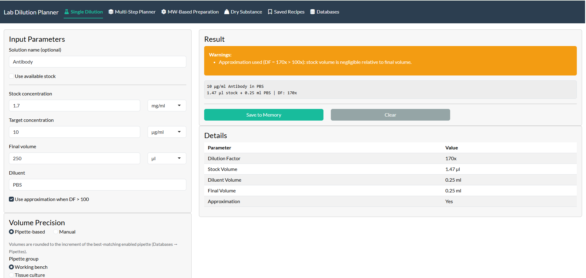
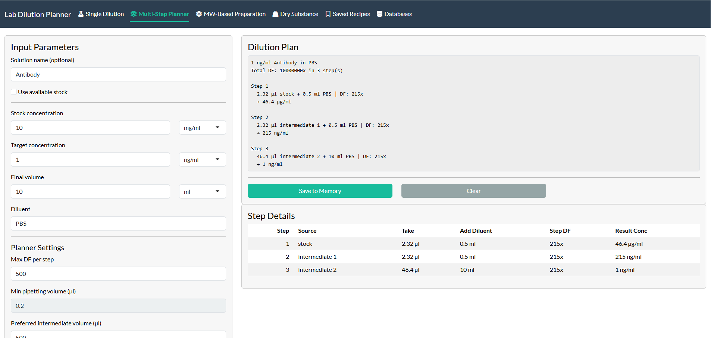
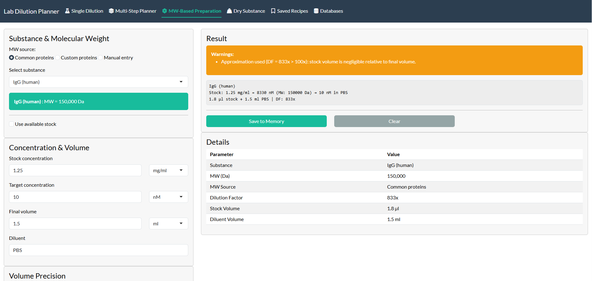
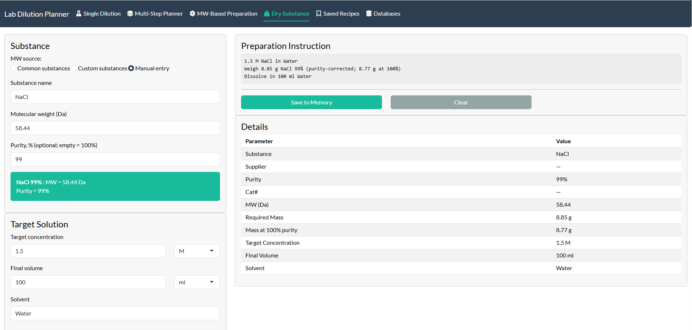
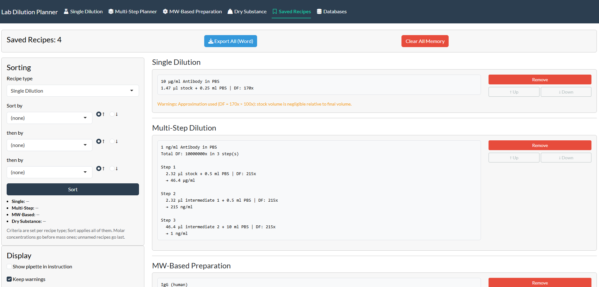
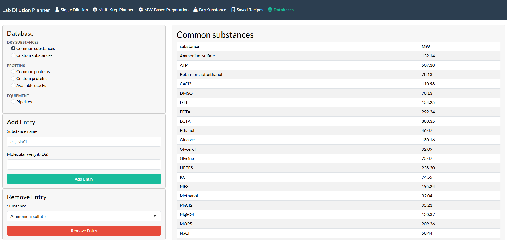
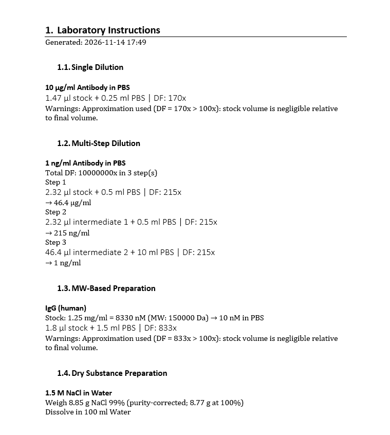

# Lab Dilution Planner

[](https://github.com/ilya-v-smirnov/dilution-maker/actions/workflows/tests.yaml)
[](LICENSE)

An R Shiny application that turns concentrations and volumes into
**step-by-step bench instructions** for biological laboratories: single and
multi-step dilutions, mass ↔ molar conversion via molecular weight, and
solution preparation from powder, with Word and Excel export.

The output is a ready-to-follow instruction, not just a number:

```
10 µg/ml Antibody in PBS
1.47 µl stock + 0.25 ml PBS | DF: 170x
```



## Contents

- [Features](#features)
- [Installation](#installation)
- [Running the app](#running-the-app)
- [Calculation rules](#calculation-rules)
- [Export](#export)
- [Databases](#databases)
- [Project structure](#project-structure)
- [Tests](#tests)
- [Disclaimer](#disclaimer)
- [License and author](#license-and-author)

## Features

### Single Dilution

Stock → target dilution (C₁V₁ = C₂V₂) for mass (pg/ml – mg/ml) or molar
(pM – M) concentrations. Shows the dilution factor, stock and diluent
volumes, and warnings (small pipetting volumes, very large dilution factors,
impossible dilutions). The stock concentration can be taken from the
**Available stocks** database.

### Multi-Step Planner

Splits a large dilution into equal sequential steps so that no step exceeds
the maximum dilution factor and no transfer is below the minimum pipetting
volume. Intermediate volumes are enlarged automatically when the next step
needs more than the preferred volume.



### MW-Based Preparation

Dilution when the stock and the target are in different kinds of units, e.g.
an antibody stock in mg/ml diluted to nM. The molecular weight comes from the
**Common/Custom proteins** databases or is entered manually.



### Dry Substance

Mass of powder to weigh for a target concentration and volume. Substances
come from the **Common/Custom substances** databases or are entered manually.
Custom substances can record a supplier, purity and catalogue number; the mass
to weigh is **corrected for purity** (an empty purity counts as 100%).



### Volume Precision

Single Dilution, Multi-Step Planner and MW-Based Preparation share a
*Volume Precision* panel:

- **Pipette-based** (default): each volume is rounded to the increment of the
  best-matching enabled pipette of the selected pipette group; the pipette
  name can be shown in the instruction, e.g. `58.8 µl (P100)`.
- **Manual**: volumes are rounded to a chosen number of significant figures
  (separately for stock and diluent).

### Saved Recipes

Every calculation can be saved to the session memory. Saved recipes are
grouped by scenario, can be reordered (Up/Down) or sorted by name, target
concentration and final volume, and exported to Word or Excel.



### Databases

Molecular weights, available stocks and pipettes are edited inside the app
(**Databases** tab) and saved to Excel files (see [Databases](#databases)).



## Installation

Requirements:

- **R 4.6.x** – the package versions are locked for this R version in
  `renv.lock` ([download R](https://cran.r-project.org/)). With another R
  version the packages may have to be compiled from source, which on Windows
  requires [Rtools](https://cran.r-project.org/bin/windows/Rtools/).
- Optional: [RStudio](https://posit.co/download/rstudio-desktop/).

Get the code (or download the ZIP from GitHub and unpack it):

```bash
git clone https://github.com/ilya-v-smirnov/dilution-maker.git
```

Install the packages once. Open `dilution-maker.Rproj` in RStudio (or start R
in the project folder) and run:

```r
source("setup.R")
```

`setup.R` installs [renv](https://rstudio.github.io/renv/) if needed and
restores the exact package versions from `renv.lock` into a project-private
library; your other R projects are not affected.

## Running the app

- **Windows:** double-click `run_app.bat`. It finds the R version recorded in
  `renv.lock` (or the newest installed R) and opens the app in the browser.
  Close the console window to stop the app.
- **RStudio / R console** (any OS), from the project folder:

  ```r
  source("run_app.R")
  ```

On the first run, missing packages are installed automatically (as in
`setup.R`), and missing database files are created (see
[Databases](#databases)).

## Calculation rules

All calculations use full precision in internal units: g/L for mass
concentrations, mol/L for molar concentrations and L for volumes. Only the
displayed values are rounded.

| Quantity | Formula |
|---|---|
| Dilution factor | DF = C<sub>stock</sub> / C<sub>target</sub> |
| Stock volume | V<sub>stock</sub> = V<sub>final</sub> / DF |
| Diluent volume | V<sub>diluent</sub> = V<sub>final</sub> − V<sub>stock</sub> |
| Mass → molar | C [mol/L] = C [g/L] / MW [g/mol] |
| Molar → mass | C [g/L] = C [mol/L] × MW [g/mol] |
| Mass of powder | m = C × V × MW / (purity / 100); for mass targets m = C × V / (purity / 100) |

**Approximation for large dilutions.** When DF > 100, the stock volume is
negligible and the diluent volume is taken equal to the final volume
(`10 ml / 170 = 58.8 µl stock + 10 ml PBS`). In Single Dilution this can be
switched off; the instruction then shows the exact diluent volume.

**Multi-step planning.** The number of steps is
n = ⌈log(DF<sub>total</sub>) / log(DF<sub>max</sub>)⌉, and every step uses
the same factor DF<sub>total</sub><sup>1/n</sup>. If any transfer would be
below the minimum pipetting volume, a step is added (up to 10 steps).
Intermediates have the preferred volume (default 500 µl) unless the next step
needs more; then the volume is increased to the required amount + 10%,
rounded up to 2 significant figures. In pipette-based mode the minimum
pipetting volume equals the minimum of the smallest enabled pipette.

**Rounding.** Displayed values have 3 significant figures without trailing
zeros (`58.8 µl`, `0.99 ml`, `170x`). Display units are chosen automatically
(volumes below 100 µl in µl, below 1 L in ml).

**Pipette selection** (pipette-based precision), for a volume V:

1. pipettes whose range covers V → the one with the smallest increment
   (ties: the narrower range);
2. V above every range → the largest pipette (several aspirations);
3. V below every range → the smallest pipette, with a warning;
4. V in a gap between ranges → the nearest smaller pipette, with a warning.

The volume is then rounded to a multiple of that pipette's increment.

**Warnings** are shown (and can be exported) for stock volumes below 2 µl,
1 µl and 0.5 µl, dilution factors above 1000, negative diluent volumes (the
stock is weaker than the target), enlarged intermediates, volumes outside the
enabled pipettes and masses below 1 mg or 1 µg.

## Export

From the **Saved Recipes** tab:

- **Export All (Word)** – one `.docx` (`lab_instructions_<date>_<time>.docx`)
  with all saved instructions grouped by scenario, optionally with pipette names and warnings.
- **Excel** – one `.xlsx` per scenario (e.g.
  `dry_substance_preparation_20261114_175300.xlsx`) with the instruction text
  and the input parameters (MW and its source, supplier, purity, catalogue number,
  purity-corrected mass, volume precision settings).



## Databases

Databases are Excel files in the `data/` folder. They are edited from the
**Databases** tab; editing in Excel also works while the app is closed.

```
data/
├── common_substances.xlsx         Common substances  (ships with the app)
├── common_proteins.xlsx           Common proteins    (ships with the app)
└── private/                       your own data – not tracked by git
    ├── custom_substances.xlsx
    ├── custom_proteins.xlsx
    ├── available_stocks.xlsx
    └── pipettes.xlsx
```

Missing files are created when the app starts: Common databases from the
built-in lists, Custom databases and Available stocks empty, Pipettes with a
standard Gilson PIPETMAN set (P2–P1000). Existing files are never
overwritten.

`data/private/` is listed in `.gitignore`, so your reagents, stocks and
pipettes stay on your computer. **Back up this folder yourself.**

| File | Sheet | Columns |
|---|---|---|
| `common_substances.xlsx` | Common substances | `substance`, `MW` |
| `common_proteins.xlsx` | Common proteins | `substance`, `MW` |
| `private/custom_substances.xlsx` | Custom substances | `substance`, `MW`, `supplier`, `purity` (%), `cat` |
| `private/custom_proteins.xlsx` | Custom proteins | `substance`, `MW` |
| `private/available_stocks.xlsx` | Available stocks | `substance`, `date`, `conc`, `units`, `comments` |
| `private/pipettes.xlsx` | Pipettes | `group`, `name`, `min_volume`, `max_volume`, `increment` (µl), `enabled` |
| | Groups | `group` (pipette groups in creation order) |

MW is in Da (g/mol). Stock `units` are any of the app's concentration units
(e.g. `mg/ml`, `µM`). A stock is matched to a protein by its `substance` name.

> **Updating an older copy.** Versions before November 2026 kept all
> databases in `data/molecular_weights_*.xlsx`, `data/available_stocks.xlsx`
> and `data/pipettes.xlsx`, tracked by git. A `git pull` into such a copy
> deletes these files. Copy them somewhere safe first, then move their custom
> sheets, stocks and pipettes into the files in `data/private/`.

## Project structure

```
app.R                     UI and server: tabs and databases
R/
├── unit_conversion.R     units ↔ internal units
├── dilution_calculations.R   single-step dilution
├── dilution_planner.R    multi-step planner
├── molarity_calculations.R   MW conversion, dry substance (purity)
├── pipettes.R            pipette database, selection and rounding
├── formatting.R          significant figures, display units
├── validation.R          input checks and warnings
├── mw_database.R         database files: load, save, create missing
├── memory_manager.R      saved recipes, ordering and sorting
└── ui_*.R                one Shiny module per tab (+ volume precision panel)
data/                     databases (see above)
tests/testthat/           test suite
setup.R, run_app.R        install packages, start the app
run_app.bat               Windows launcher (uses tools/find_rscript.ps1)
run_tests.R               run the test suite
renv.lock                 locked package versions
```

Each calculation returns the same result structure (scenario type, solution
name, instruction text, input and normalized parameters, steps, warnings,
technical metadata), which is used for display, memory, and export.

## Tests

The `tests/testthat` suite (300 checks) covers unit conversion, formatting,
all calculation scenarios with hand-calculated reference values, pipette
selection, saved recipes, database files, Word/Excel export, and every tab
through `shiny::testServer`. Tests run in temporary folders and never modify
`data/`.

```r
source("run_tests.R")
```

The suite also runs on GitHub Actions on every push to `main`.

## Disclaimer

The app is a planning aid. Check calculated amounts before use, especially
for critical reagents, and verify molecular weights, purities and stock
concentrations against the manufacturer's documentation. The software is
provided "as is", without warranty of any kind (see [LICENSE](LICENSE)).

## License and author

Released under the [MIT License](LICENSE).

Ilya Smirnov — <smirnov.iv.mail@gmail.com>
